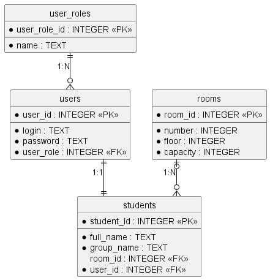
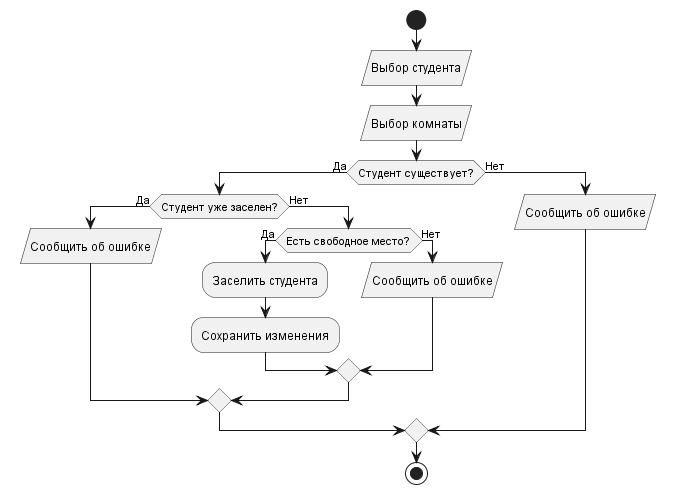
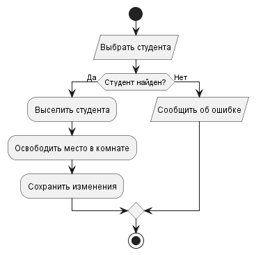
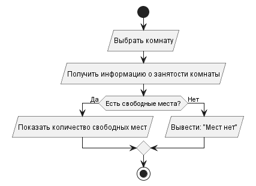

# Residio

Residio — консольное приложение для учёта комнат общежития и проживающих в нём студентов. Проект предназначен для автоматизации заселения и выселения студентов, управления жилищным фондом и контроля занятости комнат.

**Автор:** Климов Василий Андреевич, группа 26-ИВТ-4-2

## Возможности

В проекте предусмотрены следующие основные возможности:
- хранение информации о комнатах, студентах и учётных записях в реляционной базе данных SQLite;
- регистрация новых студентов и авторизация пользователей с разграничением прав доступа по ролям (Администратор / Студент);
- управление комнатами: добавление, редактирование, удаление, просмотр списка всех комнат и фильтрация только свободных;
- заселение и переселение студентов с автоматическим контролем вместимости комнаты;
- выселение студентов из комнат;
- просмотр администратором списка жильцов конкретной комнаты и управление профилями студентов;
- просмотр студентом информации о своей текущей комнате и соседях;
- автоматическое развёртывание базы данных и наполнение тестовыми данными (seed data) при первом запуске.

## Предметная область

- **Комната (`Room`):** уникальный ID, фактический номер комнаты, этаж, максимальная вместимость.
- **Студент (`Student`):** уникальный ID, ФИО, учебная группа, ссылка на комнату проживания (может быть не заселён), ссылка на учётную запись.
- **Пользователь (`User`):** уникальный ID, логин, пароль, ссылка на роль в системе.
- **Роль пользователя (`UserRole`):** уникальный ID роли, название роли (`Administrator` / `Student`).

Задача системы — обеспечить удобный учёт студентов и отслеживание статуса комнат, а также исключить логические ошибки (например, заселение в переполненную комнату или удаление комнаты, в которой числятся жильцы) за счёт строгой валидации на уровне бизнес-логики и внешних ключей БД.

## Пользователи и роли

| Роль | Возможности |
|---|---|
| **Администратор общежития** | Просматривает все комнаты и свободные места, добавляет/изменяет/удаляет комнаты, просматривает жильцов комнаты, регистрирует, редактирует и удаляет студентов, заселяет и выселяет жильцов, добавляет новых администраторов. |
| **Студент** | Авторизуется в личном кабинете, узнаёт статус своего заселения, номер своей комнаты, этаж и список соседей по комнате. |

## Структура проекта

```text
Residio/
│
├── docs/                                # Документация проекта
│   └── diagrams/                        # Диаграммы архитектуры и процессов (PlantUML)
│       ├── Use Case Diagram.png         # Изображение UseCase-диаграммы
│       ├── usecase.puml                 # Исходник UseCase-диаграммы
│       ├── er.png                       # Изображение ER-диаграммы базы данных
│       ├── er.puml                      # Исходник ER-диаграммы
│       ├── check-in.png                 # Изображение диаграммы процесса заселения
│       ├── check-in.puml                # Исходник диаграммы заселения
│       ├── check-out.png                # Изображение диаграммы процесса выселения
│       ├── check-out.puml               # Исходник диаграммы выселения
│       ├── free-place.png               # Изображение диаграммы проверки свободных мест
│       └── free-place.puml              # Исходник диаграммы свободных мест
│
├── src/                                 # Исходный код приложения
│   └── residio/                         # Главный пакет приложения
│       ├── __init__.py
│       ├── main.py                      # Точка входа в приложение (главный цикл)
│       ├── residio.db                   # Файл базы данных SQLite
│       │
│       ├── database/                    # Слой конфигурации и инициализации БД
│       │   ├── __init__.py
│       │   ├── database.py              # Подключение к SQLite и авто-миграция схемы
│       │   ├── init_db.py               # Утилита принудительного пересоздания и просмотра БД
│       │   └── schema.sql               # SQL-скрипт со структурой таблиц и начальными данными
│       │
│       ├── models/                      # Слой моделей данных (Dataclasses)
│       │   ├── __init__.py
│       │   ├── room.py                  # Модель комнаты (Room)
│       │   ├── student.py               # Модель студента (Student)
│       │   ├── user.py                  # Модель пользователя (User)
│       │   └── user_role.py             # Модель роли пользователя (UserRole)
│       │
│       ├── repositories/                # Слой доступа к данным (Data Access Layer / SQL CRUD)
│       │   ├── __init__.py
│       │   ├── room_repository.py       # SQL-запросы к таблице rooms
│       │   ├── student_repository.py    # SQL-запросы к таблице students (с JOIN комнат и логинов)
│       │   ├── user_repository.py       # SQL-запросы к таблице users
│       │   └── user_role_repository.py  # SQL-запросы к таблице user_roles
│       │
│       ├── services/                    # Слой бизнес-логики (Business Logic Layer)
│       │   ├── __init__.py
│       │   ├── auth_service.py          # Логика входа, регистрации студентов и создания админов
│       │   ├── room_service.py          # Контроль вместимости, поиск свободных мест, валидация комнат
│       │   └── student_service.py       # Бизнес-правила заселения, переселения и выселения
│       │
│       └── ui/                          # Слой представления (Presentation Layer / Консольный UI)
│           ├── __init__.py
│           ├── auth.py                  # Экраны ввода логина/пароля и регистрации
│           ├── admin_menu.py            # Интерактивные меню администратора (комнаты, студенты)
│           └── student_menu.py          # Личный кабинет студента
│
├── tests/                               # Автоматизированные тесты
│   ├── __init__.py
│   └── test_main.py
│
├── .gitignore                           # Исключения для системы контроля версий Git
├── requirements.txt                     # Зависимости проекта
└── README.md                            # Описание проекта
```

### Основные компоненты

- **`main.py`** — точка входа в приложение. Запускает главный цикл программы и распределяет пользователей по соответствующим ролевым меню после авторизации.
- **`database/`** — отвечает за физическое подключение к файлу `residio.db`, включение поддержки внешних ключей (`PRAGMA foreign_keys = ON`) и автоматическое развёртывание таблиц при первом запуске.
- **`models/`** — содержит дата-классы (`@dataclass`), которые служат типизированными контейнерами для передачи данных между базой данных, сервисами и интерфейсом.
- **`repositories/`** — изолирует все SQL-запросы (`SELECT`, `INSERT`, `UPDATE`, `DELETE`) и преобразует строки БД в объекты моделей.
- **`services/`** — содержит ключевые бизнес-правила и проверки (например, запрет на уменьшение вместимости комнаты ниже числа уже живущих там студентов или запрет на удаление заселённой комнаты).
- **`ui/`** — отвечает за консольный ввод-вывод, отображение меню и перехват исключений (`try...except`) для вывода понятных сообщений об ошибках пользователю.

## Архитектура

Приложение спроектировано по классической многослойной (N-Tier) архитектуре:

```text
Пользователь
     │
     ▼
Presentation Layer (ui: консольные меню, чтение ввода, вывод данных)
     │
     ▼
Business Logic Layer (services: правила заселения, валидация, проверка ролей)
     │
     ▼
Data Access Layer (repositories: параметризованные SQL-запросы, маппинг моделей)
     │
     ▼
Database Layer (database / SQLite: хранение данных в residio.db, контроль внешних ключей)
```

| Уровень | Пакет | Назначение |
|---|---|---|
| **Presentation Layer** | `ui`, `main.py` | Взаимодействие с пользователем через терминал |
| **Business Logic Layer** | `services` | Проверка бизнес-правил и координация операций |
| **Data Access Layer** | `repositories` | Выполнение CRUD-запросов к базе данных |
| **Data Layer & Models** | `database`, `models` | Хранение данных в SQLite и структуры сущностей |

## Диаграммы и блок-схемы

### Диаграмма прецедентов (Use Case)


### ER-диаграмма базы данных


### Заселение студента


### Выселение студента


### Проверка свободных мест


## Требования

Для запуска проекта необходимы:
- **Python 3.10+** (используется современный синтаксис аннотации типов `int | None`);
- **Git**.

Внешние библиотеки для базовой работы не требуются — проект использует стандартную библиотеку Python (`sqlite3`, `dataclasses`, `pathlib`).

## Установка и запуск

1. Клонируйте репозиторий и перейдите в директорию проекта:
```bash
git clone [https://github.com/klimovvasko-stack/Residio.git](https://github.com/klimovvasko-stack/Residio.git)
cd Residio
```

2. Запустите приложение:
```bash
python src/residio/main.py
```

При первом запуске программа автоматически создаст файл базы данных `src/residio/residio.db`, развернёт таблицы и заполнит их демонстрационными данными.

После запуска в консоли откроется главное меню:
```text
====================================
   Система общежития «Residio»
====================================
1. Войти в систему
2. Регистрация студента
0. Выход из программы
Выберите действие:
```

### Тестовые учётные записи (создаются по умолчанию)

| Роль | Логин | Пароль | Примечание |
|---|---|---|---|
| **Администратор** | `admin` | `admin123` | Полный доступ к управлению комнатами и студентами |
| **Студент** | `ivanov` | `pass1` | Заселён в комнату №101 |
| **Студент** | `volkova` | `pass6` | Не заселена (для проверки заселения) |

### Принудительный сброс и проверка базы данных

Для пересоздания таблиц из `schema.sql` и вывода текущего содержимого всех таблиц в консоль предусмотрен служебный скрипт:
```bash
python src/residio/database/init_db.py
```

## Работа в Visual Studio Code

1. Выберите интерпретатор Python из виртуального окружения (если используется):
   `.venv\Scripts\python.exe`
2. Конфигурация запуска расположена в `.vscode/launch.json`.
3. Для корректного разрешения импортов внутри пакета `src/residio` запускайте файл `src/residio/main.py`.

## Используемые технологии

- **[Python 3](https://www.python.org/)** (`sqlite3`, `dataclasses`, `pathlib`);
- **SQLite** — реляционная СУБД;
- **PlantUML** и **Markdown** — проектирование диаграмм и документация;
- **Git**, **GitHub**, **Visual Studio Code**.

## Лицензия

Проект разработан в учебных целях.